# Lab9Web — Praktikum 9: PHP Modular

Repository tugas Praktikum 9 mata kuliah **Pemrograman Web**.

## Identitas
| | |
|---|---|
| Nama | Gina Mutmainah |
| NIM | 312510490 |
| Kelas | 1252A |
| Program Studi | Teknik Informatika |
| Fakultas | Teknik |
| Universitas | Universitas Pelita Bangsa |
| Dosen Pengampu | Agung Nugroho, S.Kom., M.Kom. |

## Daftar Isi
1. [Identitas](#identitas)
2. [Deskripsi](#deskripsi) dan [Tujuan](#tujuan)
3. [Kebutuhan](#kebutuhan)
4. [Isi repository](#isi-repository) dan [Penjelasan file utama](#penjelasan-file-utama)
5. [Cara menjalankan](#cara-menjalankan) dan [Konfigurasi](#konfigurasi)
6. [Daftar rute](#daftar-rute)
7. [Fitur keamanan](#fitur-keamanan) dan [Fitur tambahan](#fitur-tambahan-tantangan)
8. [Database](#database) dan [Daftar function](#daftar-function)
9. [Hasil pengujian](#hasil-pengujian)
10. [Kendala dan solusi](#kendala-dan-solusi)
11. [Jawaban analisis dan pertanyaan pemahaman](#jawaban-analisis-dan-pertanyaan-pemahaman)
12. [Screenshot](#screenshot)

## Deskripsi
Praktikum ini terdiri dari dua bagian. **Bagian 1** (`lab9_php_modular/`) berisi latihan dasar:
`include` vs `require`, template header/footer, dan function. **Bagian 2** (`project/`)
adalah aplikasi CRUD pengguna yang sudah dipecah menjadi struktur modular dan memakai router
berbasis parameter URL dengan whitelist.

## Tujuan
Menerapkan modularisasi program PHP: template bersama (header/footer), function/helper,
struktur direktori, dan routing berbasis parameter URL (`index.php?page=...`) pada aplikasi CRUD.

## Kebutuhan
- PHP 8.1+ (memakai `str_starts_with`, PDO)
- Apache + MySQL/MariaDB (XAMPP/Laragon)
- Browser dan VS Code

## Isi repository
```
Lab9Web/
├── README.md
├── lab9_php_modular/           # Bagian 1: include/require, template, function
│   ├── pesan.php, uji-include.php, uji-require.php
│   ├── header.php, footer.php, style.css
│   ├── home.php, about.php, profil.php, kontak.php
│   ├── helpers.php, latihan-function.php
└── project/                    # Bagian 2: CRUD modular + router
    ├── index.php               # router (whitelist)
    ├── .htaccess               # opsional: URL rewrite
    ├── database.sql
    ├── config/database.php     # satu-satunya koneksi DB (PDO)
    ├── views/                  # header, footer, dashboard, demo, 404
    ├── helpers/functions.php   # e, url, asset, redirect, formatRupiah, hitungDiskon,
    │                           # validasiEmail, ringkasTeks, flash, CSRF, isActive
    ├── modules/user/           # list, add, edit, delete (+ _form.php)
    └── assets/css, assets/js
├── screenshots/                # 17 bukti hasil pengujian (dipakai di laporan)
└── laporan/                    # Laporan Praktikum 9 (Word)
```

## Cara menjalankan
**Bagian 1:** salin `lab9_php_modular/` ke `htdocs`, buka `http://localhost/lab9_php_modular/home.php`.

**Bagian 2:**
1. Salin `project/` ke `htdocs` (mis. `htdocs/project`).
2. Jalankan Apache + MySQL, import `project/database.sql` lewat phpMyAdmin.
3. Sesuaikan user/password di `project/config/database.php` bila perlu.
4. Buka `http://localhost/project/index.php`.

## Penjelasan file utama
| File | Peran |
|---|---|
| `project/index.php` | Titik masuk dan router: `session_start()`, `ob_start()`, memuat helper dan koneksi DB, memvalidasi `page` lewat whitelist `$routes`, lalu memuat header, konten, dan footer |
| `project/config/database.php` | Satu-satunya tempat koneksi PDO (mode exception, fetch assoc, charset utf8mb4) |
| `project/helpers/functions.php` | Function umum: `e`, `url`, `asset`, `redirect`, format dan validasi, flash message, CSRF, menu aktif |
| `project/views/header.php`, `footer.php` | Template bersama (navigasi, pesan flash, penutup halaman dan `app.js`) |
| `project/views/dashboard.php`, `demo.php`, `404.php` | Halaman ringkasan, demo helper, dan halaman tidak ditemukan |
| `project/modules/user/*.php` | CRUD pengguna; `_form.php` adalah partial form yang dipakai `add.php` dan `edit.php` |
| `project/assets/css/style.css`, `assets/js/app.js` | Gaya tampilan dan konfirmasi sebelum hapus (atribut `data-confirm`) |
| `project/.htaccess` | Opsional: menulis ulang URL (mis. `/project/user/list` menjadi `index.php?page=user/list`) |

## Konfigurasi
- Koneksi database default: host `localhost`, database `db_latihan`, user `root`, password kosong (bawaan XAMPP). Ubah di `project/config/database.php` bila berbeda.
- `BASE_URL` ditentukan otomatis dari lokasi `index.php`, sehingga folder project boleh diberi nama lain.
- URL rewrite di `.htaccess` memerlukan `mod_rewrite` aktif dan `AllowOverride All`. Tanpa itu aplikasi tetap berjalan lewat `index.php?page=...`.

## Daftar rute
| Rute (`?page=`) | File | Keterangan |
|---|---|---|
| `dashboard` (default) | views/dashboard.php | Ringkasan data |
| `user/list` | modules/user/list.php | Daftar pengguna |
| `user/add` | modules/user/add.php | Tambah (POST + CSRF) |
| `user/edit&id=N` | modules/user/edit.php | Ubah (POST + CSRF) |
| `user/delete` | modules/user/delete.php | Hapus, hanya POST + CSRF |
| `demo` | views/demo.php | Demo seluruh helper |
| selain di atas | views/404.php | Status HTTP 404 |

## Fitur keamanan
- **Whitelist rute:** nilai `page` tidak pernah dipakai langsung sebagai path file (mencegah path traversal / Local File Inclusion).
- **Escape output:** semua data yang dicetak ke HTML melewati `e()` (`htmlspecialchars`) untuk mencegah XSS.
- **Prepared statement PDO:** semua query data pengguna memakai parameter, bukan penggabungan string (mencegah SQL injection).
- **CSRF:** form tambah, ubah, dan hapus memakai token sesi yang diverifikasi dengan `hash_equals()`.
- **Hapus hanya via POST:** akses `user/delete` lewat URL biasa (GET) ditolak.
- **Validasi input:** nama wajib diisi, email divalidasi `FILTER_VALIDATE_EMAIL` di sisi server, ID divalidasi `FILTER_VALIDATE_INT`, dan email duplikat ditangani.

## Fitur tambahan (tantangan)
- Menu aktif (`isActive()` di helper dan `views/header.php`)
- Pesan sukses/gagal (`setFlash()` / `getFlash()`)
- URL rewrite opsional lewat `.htaccess`

## Langkah praktikum singkat
1. Uji `include` vs `require` (ganti nama `pesan.php`, amati warning vs fatal error).
2. Buat template `header.php`/`footer.php`, halaman memakai `require_once`.
3. Buat function (parameter, return, default value) lalu pindah ke `helpers.php`.
4. Susun direktori `config/views/helpers/modules/assets`.
5. Buat router whitelist + halaman 404.
6. Refactor CRUD ke struktur modular, semua tautan memakai `index.php?page=...`.

## Hasil pengujian
| No | Pengujian | Hasil yang diharapkan | Status |
|---|---|---|---|
| 1 | `index.php` | Dashboard tampil | Berhasil |
| 2 | `index.php?page=user/list` | Daftar pengguna tampil | Berhasil |
| 3 | `index.php?page=user/add` | Form tambah tampil; email tidak valid ditolak dengan pesan kesalahan | Berhasil |
| 4 | `index.php?page=user/edit&id=N` | Form ubah terisi data lama; perubahan tersimpan | Berhasil |
| 5 | Tombol Hapus | Pesan sukses dan data hilang dari tabel | Berhasil |
| 6 | `index.php?page=user/delete&id=1` (GET) | Ditolak dengan pesan metode POST, data tetap ada | Berhasil |
| 7 | `index.php?page=admin/rahasia` | Halaman 404 (status HTTP 404) | Berhasil |

Bukti tiap pengujian ada pada bagian [Screenshot](#screenshot).

## Kendala dan solusi
| Kendala | Solusi |
|---|---|
| CSS tidak tampil saat URL berubah | Path aset dibuat lewat `asset()` berbasis `BASE_URL` |
| `Cannot modify header information` saat redirect | `ob_start()` di `index.php` |
| `Function already declared` | Pakai `require_once` untuk helper |
| Hapus data lewat URL GET berisiko | Hapus hanya via POST + token CSRF |

## Jawaban analisis dan pertanyaan pemahaman

### Analisis hasil template (bagian D)
1. **Bagian yang dipakai bersama:** header (head HTML, judul, navigasi) dan footer (penutup halaman).
2. **Jika teks navigasi diubah di header.php:** perubahan langsung terlihat di semua halaman yang memuat header tersebut.
3. **Mengapa konten tidak seluruhnya di header.php:** header hanya untuk bagian yang sama di semua halaman; konten tiap halaman berbeda dan harus ada di file masing-masing.
4. **Manfaat require_once vs menyalin header:** tidak ada duplikasi, perubahan cukup di satu file, mudah dirawat, dan file tidak termuat dua kali.

### Pertanyaan pemahaman
1. **Modularisasi** adalah membagi aplikasi menjadi bagian-bagian kecil berdasarkan tanggung jawabnya. Manfaat: (a) kode bisa dipakai ulang, (b) perawatan lebih mudah, (c) pekerjaan tim bisa dibagi per modul, (d) lebih mudah dibaca/diuji.
2. File tidak ditemukan: `include` hanya memberi **warning** dan eksekusi **berlanjut**; `require` memberi **fatal error** dan eksekusi **berhenti**.
3. Konfigurasi database wajib ada (tanpanya aplikasi tidak bisa jalan) sehingga `require`; `_once` mencegah dimuat/dideklarasikan ulang dan koneksi ganda.
4. **Parameter** = variabel di deklarasi function; **argumen** = nilai yang dikirim saat memanggil; **return** = nilai yang dikembalikan ke pemanggil (bisa disimpan/dihitung lagi), berbeda dengan `echo` yang hanya menampilkan.
5. Agar tidak terjadi duplikasi, perubahan tampilan cukup di satu tempat, dan konten halaman tetap fokus pada isinya.
6. `index.php` adalah titik masuk dan router: membaca parameter `page`, memvalidasi lewat whitelist, lalu memuat header + konten + footer.
7. Whitelist hanya mengizinkan halaman yang terdaftar, sehingga input pengguna tidak bisa mengakses file lain dan rute tak dikenal bisa ditangani dengan 404.
8. Risiko **path traversal / Local File Inclusion**: penyerang bisa memuat file tak dimaksud (mis. `../config/database.php`) dan membocorkan data atau menjalankan kode.
9. `RewriteCond` memberi syarat (hanya jika bukan file `-f` dan bukan direktori `-d` yang ada); `RewriteRule` mengarahkan permintaan lainnya ke `index.php?page=$1`.
10. **config**: koneksi database; **views**: header, footer, dashboard, 404; **helpers**: function umum (validasi, format, escape, flash, CSRF); **modules**: halaman CRUD (list, add, edit, delete) per fitur.

## Database
- Nama database: `db_latihan` (charset `utf8mb4`), tabel `users`.
- Kolom: `id`, `nama`, `email` (unik), `jurusan`, `alamat`, `created_at`.
- Script pembuatan tabel dan data awal ada di `project/database.sql`.

| Kolom | Tipe | Keterangan |
|---|---|---|
| `id` | INT, AUTO_INCREMENT | Primary key |
| `nama` | VARCHAR(100), NOT NULL | Nama pengguna |
| `email` | VARCHAR(150), NOT NULL, UNIQUE | Email pengguna |
| `jurusan` | VARCHAR(100), NULL | Jurusan |
| `alamat` | TEXT, NULL | Alamat |
| `created_at` | TIMESTAMP | Waktu data dibuat (default saat ini) |

Data awal: Rina Putri, Budi Santoso, dan Sari Dewi.

## Daftar function
| Function | Lokasi | Fungsi |
|---|---|---|
| `tampilkanSalam()`, `sapaPengguna()`, `hitungLuasPersegiPanjang()`, `konversiCelciusKeFahrenheit()`, `tentukanStatusNilai()`, `hitungTotal()` | lab9_php_modular/helpers.php | Latihan function |
| `e()` | kedua helper | Escape HTML (cegah XSS) |
| `formatRupiah()`, `hitungDiskon()` | kedua helper | Format rupiah dan hitung nilai diskon |
| `url()`, `asset()`, `redirect()` | project/helpers/functions.php | URL routing, path aset, dan redirect |
| `validasiEmail()`, `ringkasTeks()`, `isActive()` | project/helpers/functions.php | Validasi email, ringkas teks, penanda menu aktif |
| `setFlash()`, `getFlash()` | project/helpers/functions.php | Pesan sukses/gagal sekali tampil |
| `csrfToken()`, `csrfField()`, `csrfVerify()` | project/helpers/functions.php | Perlindungan CSRF |

## Tautan
- Laporan lengkap: `laporan/Laporan_Praktikum_9_PHP_Modular_Gina_Mutmainah.docx` (Word). Seluruh kode ditulis sebagai teks dan setiap gambar memiliki penjelasan.
- Dosen pengampu: Agung Nugroho, S.Kom., M.Kom.

## Screenshot
Berkas gambar ada di folder `screenshots/`. Nomor pada kolom "Gambar di laporan" sama dengan nomor gambar di laporan.

| No | Gambar di laporan | Bagian | Penjelasan | Gambar |
|---|---|---|---|---|
| 1 | Gambar 3.1 | Struktur direktori | Panel Explorer VS Code berisi folder lab9_php_modular, project (assets, config, helpers, modules, views), screenshots, dan index.php sebagai router yang terbuka di editor. | 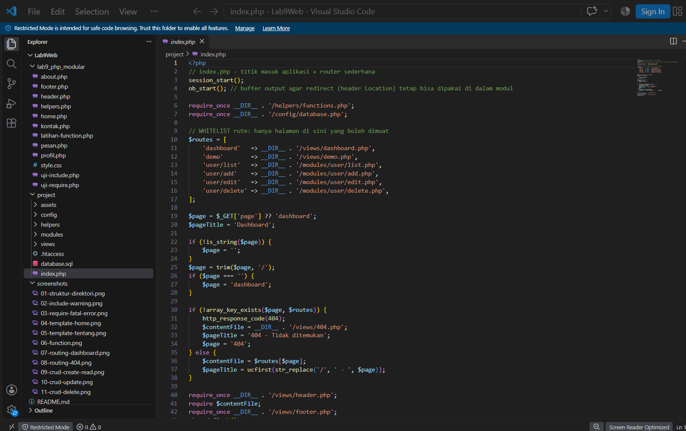 |
| 2 | Gambar 3.2 | include saat file hilang (Warning) | pesan.php tidak ada: muncul dua Warning, tetapi teks "Sesudah pemanggilan" tetap tampil karena eksekusi berlanjut. | 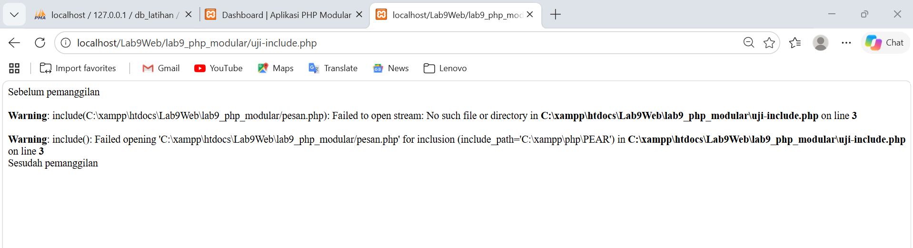 |
| 3 | Gambar 3.3 | require saat file hilang (Fatal error) | pesan.php tidak ada: muncul Warning lalu Fatal error, dan teks "Sesudah pemanggilan" tidak tampil karena eksekusi berhenti. | 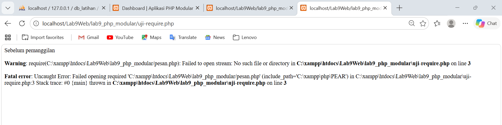 |
| 4 | Gambar 3.4 | Template: Home | home.php memakai header dan footer bersama, serta memanggil formatRupiah() dan hitungDiskon() (harga Rp 150.000, diskon 10% = Rp 15.000). | 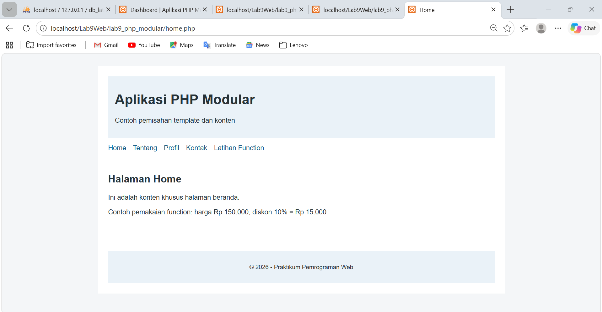 |
| 5 | Gambar 3.5 | Template: Tentang | about.php memakai header dan footer yang sama dengan Home, hanya kontennya yang berbeda. | 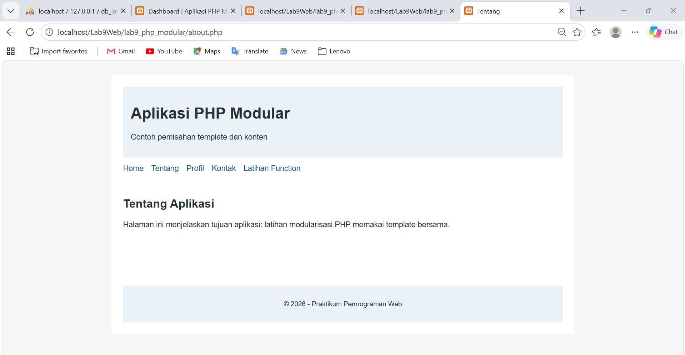 |
| 6 | Gambar 3.6 | Template: Profil | profil.php menampilkan nama, NIM, dan kelas dengan template yang sama. | 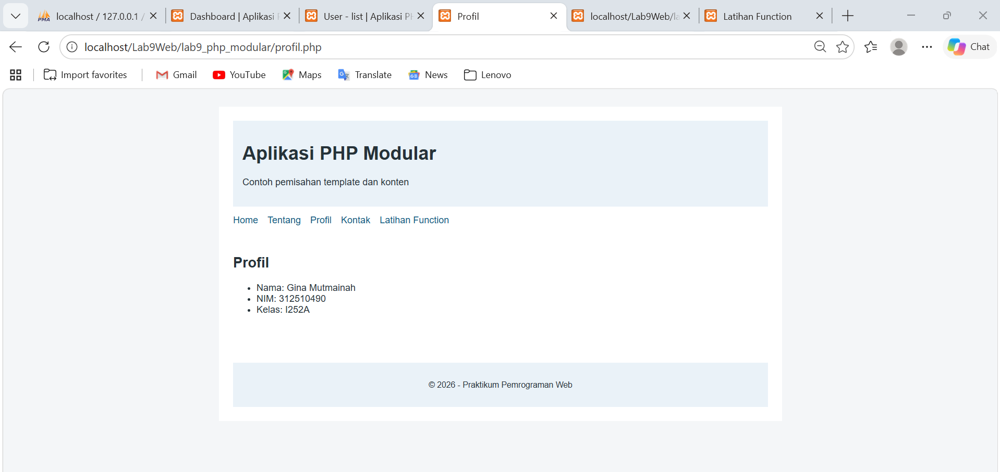 |
| 7 | Gambar 3.7 | Template: Kontak | kontak.php setelah form dikirim: pesan terima kasih tampil setelah nama dan email lolos validasi dan di-escape dengan e(). | 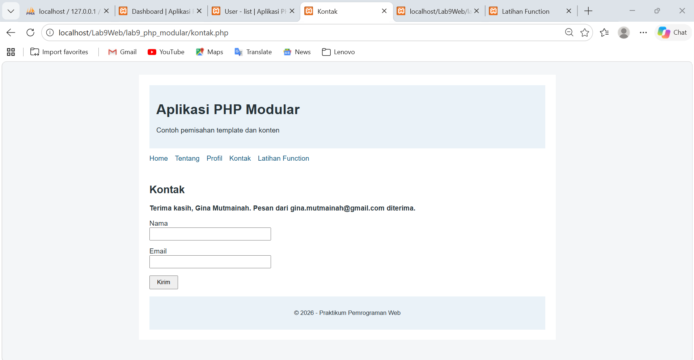 |
| 8 | Gambar 3.8 | Function | Halaman Latihan Function: hasil pemanggilan function (salam, luas, diskon, konversi suhu, status nilai, total, dan escape XSS). | 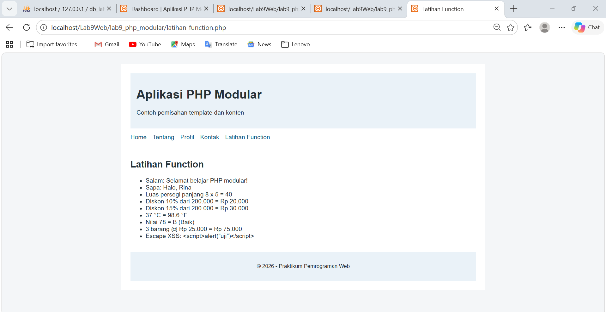 |
| 9 | Gambar 3.9 | Demo Helper | Halaman demo pada project: formatRupiah, hitungDiskon, validasiEmail, ringkasTeks, dan e(). | 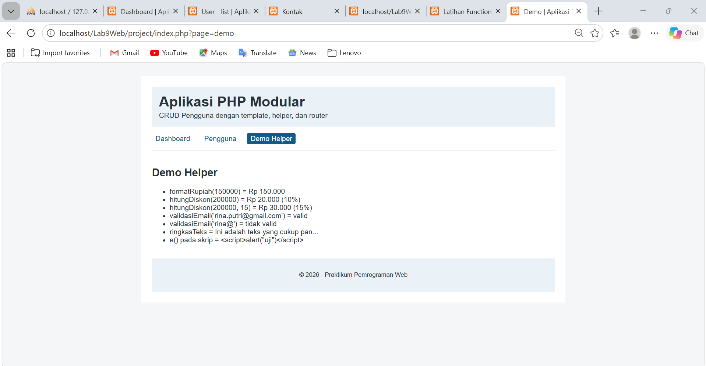 |
| 10 | Gambar 4.1 | Routing: Dashboard | Rute default (index.php): total pengguna dan tiga pengguna terbaru dari database. | 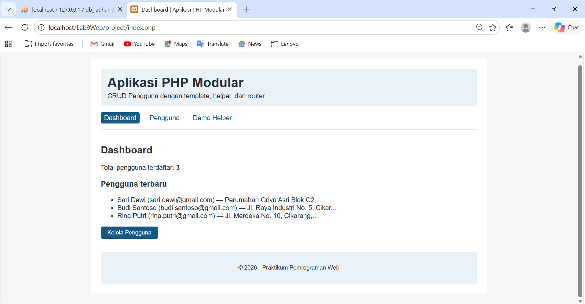 |
| 11 | Gambar 4.2 | Routing: halaman 404 | index.php?page=admin/rahasia tidak ada di whitelist sehingga router mengirim status 404 dan memuat views/404.php. | 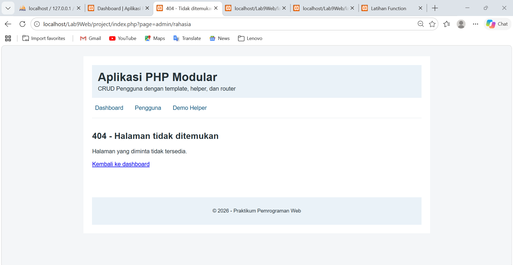 |
| 12 | Gambar 4.3 | CRUD: validasi email | Form Tambah Pengguna menolak email tidak valid, menampilkan pesan kesalahan, dan mempertahankan isian. | 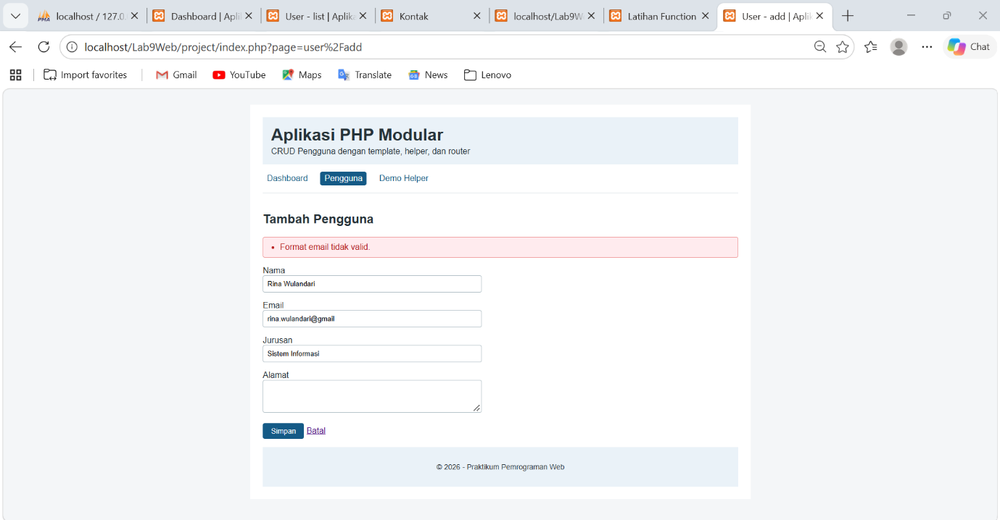 |
| 13 | Gambar 4.4 | CRUD: Create dan Read | Pesan sukses setelah menambah data, lalu daftar pengguna tampil pada tabel. | 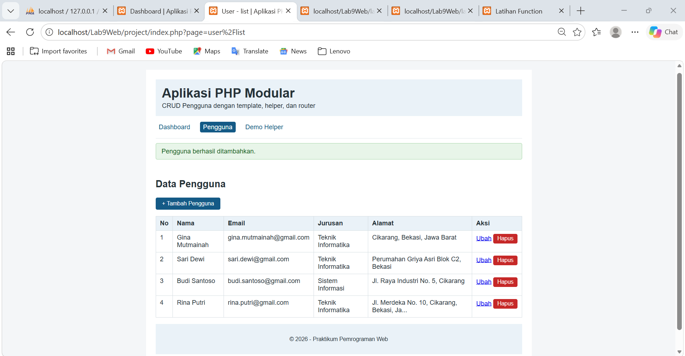 |
| 14 | Gambar 4.5 | CRUD: Update (form ubah) | Form Ubah Pengguna terisi data lama (user/edit&id=4). | 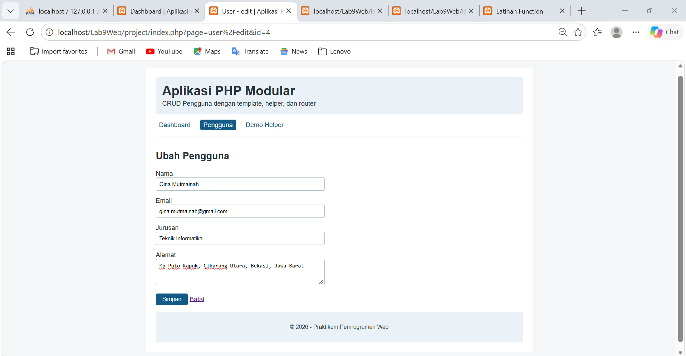 |
| 15 | Gambar 4.6 | CRUD: Update berhasil | Pesan "Data pengguna berhasil diperbarui." dan perubahan terlihat pada tabel. | 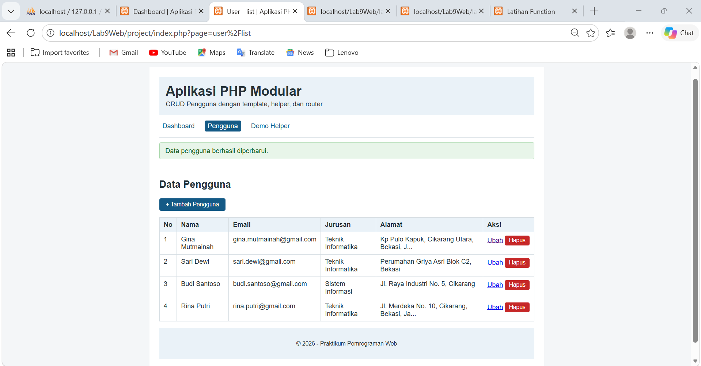 |
| 16 | Gambar 4.7 | CRUD: Delete | Pesan sukses setelah menghapus pengguna; data yang dihapus hilang dari tabel. | 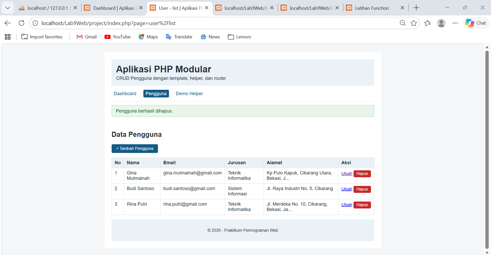 |
| 17 | Gambar 4.8 | CRUD: hapus lewat URL ditolak | Percobaan hapus lewat URL (user/delete&id=1) ditolak karena hanya menerima POST + token CSRF; data tetap ada. | 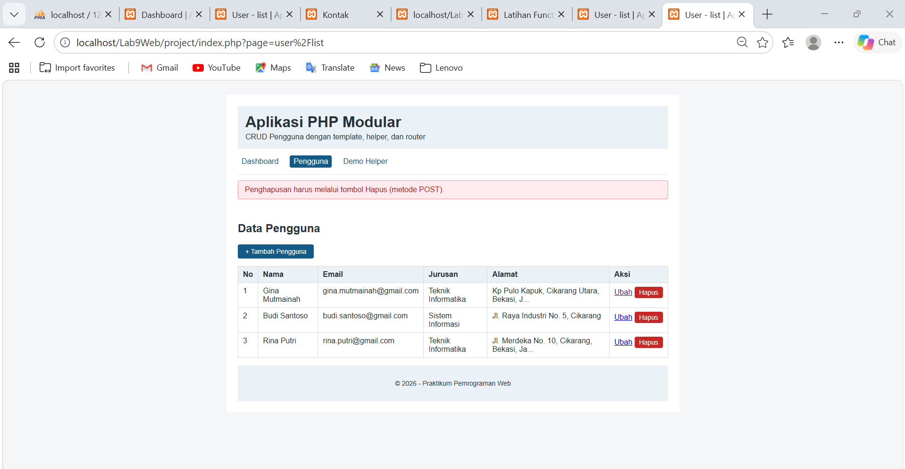 |
